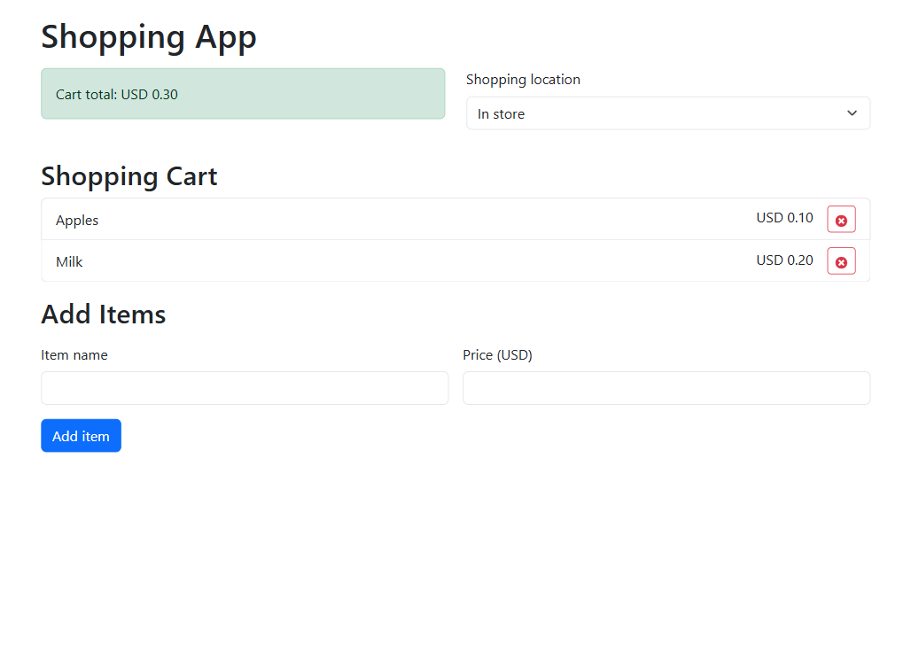

# Shopping App

A small React shopping-cart exercise, forked from the [IBM Developer Skills Network starter](https://github.com/ibm-developer-skills-network/kduia-shopping-app). Vite builds the app and Vitest runs the component tests.

The missing starter components are completed here: add named items with USD prices, remove individual items, view the running total, and choose an in-store or online shopping label. Amounts are stored as integer cents so ordinary decimal totals remain exact.

This is coursework, not an online shop. There is no checkout, payment, inventory, delivery service, account, or backend. Cart contents live in memory and reset when the page reloads. The shopping location is only a label and does not affect prices.

## Live demo

[Open the shopping-cart demo](https://sachiyacodes.github.io/kduia-shopping-app/). It runs entirely in your browser and stores no cart on a server.



## Run locally

Use Node.js 24 and npm:

```sh
npm ci
npm start
```

Open the local address printed by the development server, including `/kduia-shopping-app/`. Keep the development server on a trusted local machine.

## Checks

```sh
npm test
npm run build
npm audit
```

Tests cover adding/removing items, exact decimal totals, invalid prices, duplicate item identity, and the location control. The production bundle is written to `dist/`. Run `npm run preview` for a local preview of that bundle. CI runs the tests, production build, and dependency audit.

## Maintenance limits

The original Create React App toolchain was replaced with Vite and Vitest to remove its unpatched dependency tree. The cart behavior and regression tests are preserved. Build output now uses `dist/` rather than CRA's `build/`; update any hosting configuration accordingly. JSX source files use `.jsx` extensions, and `index.html` is the root entry point.

The app targets modern browsers. Vite uses `/kduia-shopping-app/` as its base for the GitHub Pages project site; public asset links use the same base. The Pages workflow tests, audits, builds, and deploys `dist/` after pushes to `main`. It has no production server or legacy-browser polyfills. Check `npm audit` as dependencies evolve; a clean advisory report does not prove the app secure against every possible issue.

## Attribution and license

Original learning scaffold: IBM Developer Skills Network. This fork completes the cart context/components and adds regression tests and project documentation. The original [Apache-2.0 license](LICENSE) is preserved.

## Demo verification

On November 16, 2026, all four cart tests, production build, and dependency audit passed. Both app CI and Pages deployment passed at `189b281787685c44162faaf0f46158e98748ceda`. At the live URL, adding USD 0.10 and USD 0.20 produced USD 0.30; removing each item restored USD 0.20 and then USD 0.00. The location control worked independently. All five linked assets returned HTTP 200 under the project subpath, with no browser console errors. The screenshot uses demonstration items. No package or release download is needed for this coursework demo.
